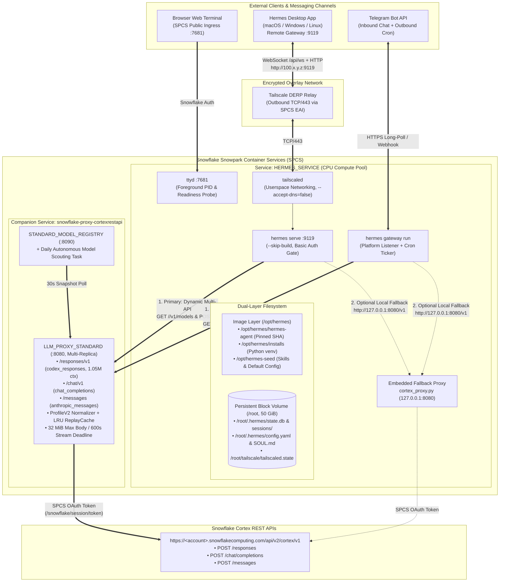
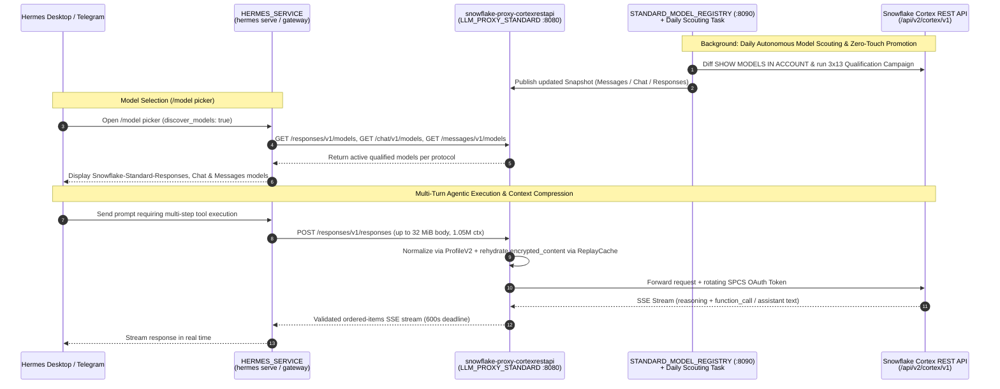
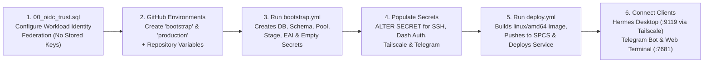

<div align="center">

# Hermes Agent on Snowflake (SPCS)

**Production-Grade Deployment of [Hermes Agent](https://hermes-agent.nousresearch.com) on Snowflake Snowpark Container Services (SPCS) with Multi-API Cortex Proxy Integration, Persistent Block Storage, Tailscale Remote Gateway & Passwordless GitHub OIDC**

[](LICENSE)
[](https://docs.snowflake.com/en/developer-guide/snowpark-container-services/overview)
[](https://github.com/fbattaglieri-snowflake/snowflake-proxy-cortexrestapi)
[](docs/client-setup.md)
[](#quickstart--local-validation)

</div>

---

> [!WARNING]
> ### IMPORTANT DISCLAIMER — NOT AN OFFICIAL SNOWFLAKE OR NOUSRESEARCH PRODUCT
> **This repository is an independent, open-source community and field-engineering reference implementation** developed and maintained by **Francesco Battaglieri** with the assistance of **Snowflake Cortex Code**.
> - It is **NOT an official release, product, service, or support offering** from **Snowflake Inc.** or **NousResearch Inc.** (authors of Hermes Agent).
> - Neither organization reviewed, approved, sponsored, endorsed, certified, or warranted this project.
> - It is provided strictly **"AS IS"** without warranty of any kind. See [DISCLAIMER.md](DISCLAIMER.md) and [LICENSE](LICENSE) for full terms.

> [!IMPORTANT]
> ### CORE ARCHITECTURAL DEPENDENCY — [`snowflake-proxy-cortexrestapi`](https://github.com/fbattaglieri-snowflake/snowflake-proxy-cortexrestapi)
> To unlock the full **Snowflake Cortex REST API** surface (**OpenAI Responses** `/responses/v1`, **OpenAI Chat Completions** `/chat/v1`, and **Anthropic Messages** `/messages`) with dynamic model discovery (`discover_models: true`), `1,050,000`-token context windows, `32 MiB` multi-turn payload support, and zero-touch daily model promotion, this deployment is designed to work alongside the companion SPCS proxy repository:
> - **Primary Shared Multi-API Proxy (Recommended):** [**`fbattaglieri-snowflake/snowflake-proxy-cortexrestapi`**](https://github.com/fbattaglieri-snowflake/snowflake-proxy-cortexrestapi)
> - **Model Qualification Harness:** [**`fbattaglieri-snowflake/cortex-model-compatibility-matrix`**](https://github.com/fbattaglieri-snowflake/cortex-model-compatibility-matrix)
> - **Embedded Single-Container Fallback:** This repository also bundles a lightweight, zero-dependency loopback proxy (`proxy/cortex_proxy.py` on `127.0.0.1:8080`) for standalone single-container Chat Completions fallback.

---

## Table of Contents

1. [Executive Overview & Why This Architecture Exists](#1-executive-overview--why-this-architecture-exists)
2. [End-to-End System Architecture (Visual Schematics)](#2-end-to-end-system-architecture)
3. [Upstream Proxy Dependency: `snowflake-proxy-cortexrestapi` vs. Embedded Fallback](#3-upstream-proxy-dependency-snowflake-proxy-cortexrestapi-vs-embedded-fallback)
4. [Container Filesystem Layout & The `/root` Block Volume Seed Pattern](#4-container-filesystem-layout--the-root-block-volume-seed-pattern)
5. [Dynamic Model Discovery & Multi-Turn Inference Flow](#5-dynamic-model-discovery--multi-turn-inference-flow)
6. [Prerequisites & Cross-Region Inference (`ANY_REGION`)](#6-prerequisites--cross-region-inference-any_region)
7. [Step-by-Step Deployment Guide (GitHub Actions OIDC)](#7-step-by-step-deployment-guide-github-actions-oidc)
8. [Repository Structure](#8-repository-structure)
9. [Quickstart & Local Validation](#quickstart--local-validation)
10. [Documentation Index](#documentation-index)

---

## 1. Executive Overview & Why This Architecture Exists

Running **Hermes Agent** inside **Snowflake Snowpark Container Services (SPCS)** — while connecting **Hermes Desktop** from any workstation, **Telegram** for mobile/autonomous messaging and cron jobs, and **Snowflake Cortex AI** as the LLM backbone — requires solving four distinct architectural challenges:

| # | Architectural Challenge | Root Cause in SPCS / Cortex | How `hermes-snowflake` Solves It |
|---|---|---|---|
| **1** | **Cortex REST API Protocol & Auth Deviations** | SPCS requires a rotating `/snowflake/session/token` (`X-Snowflake-Authorization-Token-Type: OAUTH`), while standard OpenAI/Anthropic SDKs send static `Bearer` keys and parameters (`max_tokens`, `reasoning_effort`, parallel tool calls, `thinking.type="adaptive"`, `>1 MiB` reasoning histories) that raw Cortex endpoints reject or truncate. | Connects Hermes to [**`snowflake-proxy-cortexrestapi`**](https://github.com/fbattaglieri-snowflake/snowflake-proxy-cortexrestapi) across all 3 APIs (`/responses/v1`, `/chat/v1`, `/messages/v1`) + ships `proxy/cortex_proxy.py` (`127.0.0.1:8080`) as a built-in fallback. |
| **2** | **Hermes Desktop WebSocket Connectivity** | Snowflake public HTTP ingress strips the `Authorization` header, requires Snowflake SSO/PAT login, and breaks Hermes Desktop's `/api/ws` WebSocket ticket handshake on port `9119`. | Runs **Tailscale in userspace networking mode** (`--tun=userspace-networking`, `--accept-dns=false`) over outbound **DERP TCP/443**, giving Hermes Desktop a direct, stable tailnet IP (`http://100.x.y.z:9119`) across restarts. |
| **3** | **Block Volume Masking of `/root`** | Mounting a persistent SPCS block volume at `/root` masks everything written under `/root` at `docker build` time (skills, default `config.yaml`, Python environments). | Installs the Hermes checkout and Python environments in **`/opt/hermes`** (outside `/root`), snapshots default config/skills into **`/opt/hermes-seed`**, and restores missing files with `cp -a -n` (no-clobber) at every boot. |
| **4** | **Silent Process & Cron Outages on Container Recreate** | SPCS containers have no `systemd`. `hermes gateway install` is a no-op, and `hermes serve` without `--skip-build` hangs silently trying to compile a missing web UI. | `start.sh` launches and supervises **`cortex_proxy.py`**, **`hermes gateway run`** (Telegram + cron ticker), **`tailscaled`**, and **`hermes serve --skip-build`** with dedicated background watchdogs, keeping **`ttyd :7681`** in the foreground. |

---

## 2. End-to-End System Architecture



### ASCII Architecture Quick-Reference

```text
+---------------------------------------------------------------------------------------------------+
|  EXTERNAL CLIENTS                                                                                 |
|  • Hermes Desktop (Windows/macOS/Linux) ──> Tailscale DERP (TCP/443) ──> http://100.x.y.z:9119    |
|  • Telegram App / Cron Delivery         ──> Outbound HTTPS (TCP/443) ──> hermes gateway run       |
|  • Browser Web Terminal                 ──> SPCS Public Ingress      ──> ttyd (:7681)             |
+-------------------------------------------------+-------------------------------------------------+
                                                  |
                                                  v
+---------------------------------------------------------------------------------------------------+
|  SPCS CONTAINER: HERMES_SERVICE                                                                   |
|  +----------------------------------------------+----------------------------------------------+  |
|  | Ephemeral Image Layer (/opt & /usr/local)    | Persistent Block Volume (/root — 50 GiB)     |  |
|  | • /opt/hermes/hermes-agent (Pinned Git SHA)  | • /root/.hermes/state.db (Sessions & Memory) |  |
|  | • /opt/hermes/installs (Managed Python venv) | • /root/.hermes/config.yaml & SOUL.md        |  |
|  | • /opt/hermes-seed (Skills & Config Seed)    | • /root/.hermes/skills/ (User & Seed Skills) |  |
|  | • /opt/hermes_configure.py & migrate_soul.py | • /root/tailscale/tailscaled.state (Fixed IP)|  |
|  +----------------------------------------------+----------------------------------------------+  |
|                                                                                                   |
|  Configured Providers in /root/.hermes/config.yaml (discover_models: true):                       |
|  1. snowflake-standard-responses ──> http://<proxy-host>:8080/responses/v1  (1,050,000 ctx)       |
|  2. snowflake-standard-chat      ──> http://<proxy-host>:8080/chat/v1                             |
|  3. snowflake-standard-messages  ──> http://<proxy-host>:8080/messages                            |
|  4. ollama-spcs (optional GPU)   ──> http://<ollama-host>:11434/v1                                |
|  5. snowflake-cortex-proxy (opt) ──> http://127.0.0.1:8080/v1 (Embedded Single-Container Fallback)|
+-------------------------------------------------+-------------------------------------------------+
                                                  |
                                                  v
+---------------------------------------------------------------------------------------------------+
|  COMPANION SPCS PROXY: snowflake-proxy-cortexrestapi (LLM_PROXY_STANDARD :8080 + REGISTRY :8090)  |
|  • Terminates internal SPCS requests & injects rotating /snowflake/session/token (OAUTH)          |
|  • Normalizes ProfileV2 options, deduplicates tool_call IDs, rehydrates encrypted reasoning       |
|  • Ordered-items SSE streaming, 32 MiB payload support, 600s compression deadline                 |
|  • Daily Autonomous Model Scouting Task promotes newly qualified Cortex models zero-touch         |
+-------------------------------------------------+-------------------------------------------------+
                                                  |
                                                  v
+---------------------------------------------------------------------------------------------------+
|  SNOWFLAKE CORTEX REST API (/api/v2/cortex/v1/{responses, chat/completions, messages})            |
+---------------------------------------------------------------------------------------------------+
```

---

## 3. Upstream Proxy Dependency: `snowflake-proxy-cortexrestapi` vs. Embedded Fallback

Hermes on SPCS supports **two proxy topologies**. By default, `hermes_configure.py` configures the **Shared Multi-API Standard Proxy** topology.

### Topology A (Default & Recommended): Shared Multi-API Proxy — [`snowflake-proxy-cortexrestapi`](https://github.com/fbattaglieri-snowflake/snowflake-proxy-cortexrestapi)

Deploy [**`fbattaglieri-snowflake/snowflake-proxy-cortexrestapi`**](https://github.com/fbattaglieri-snowflake/snowflake-proxy-cortexrestapi) in your Snowflake account and point `STANDARD_PROXY_ORIGIN` (e.g., `http://llm-proxy-standard.core.svc.spcs.internal:8080`) to its internal SPCS DNS address.

`hermes_configure.py` registers three native providers with **`discover_models: true`**:

| Hermes Provider Slug | Display Name in `/model` Picker | Proxy Endpoint | Hermes `api_mode` | Default Model & Context |
|---|---|---|---|---|
| `snowflake-standard-responses` *(default)* | **`Snowflake-Standard-Responses`** | `${STANDARD_PROXY_ORIGIN}/responses/v1` | `codex_responses` | `openai-gpt-6-astra` (`1,050,000` tokens) |
| `snowflake-standard-chat` | **`Snowflake-Standard-Chat`** | `${STANDARD_PROXY_ORIGIN}/chat/v1` | `chat_completions` | `openai-gpt-6-luna` |
| `snowflake-standard-messages` | **`Snowflake-Standard-Messages`** | `${STANDARD_PROXY_ORIGIN}/messages` | `anthropic_messages` | `claude-opus-5-5` |

#### Why `snowflake-proxy-cortexrestapi` is Essential for Full Multi-API Operation

- **All 3 Cortex API Surfaces:** Native access to **OpenAI Responses** (`/responses/v1` for `openai-gpt-6-astra`, `openai-gpt-6.1-sol`, `openai-gpt-6.1-terra`), **OpenAI Chat Completions** (`/chat/v1` for `openai-gpt-6-luna`, `openai-gpt-6-sol`, `grok-4.6`, `grok-4.7`, `kimi-k3`, `glm-5.3`), and **Anthropic Messages** (`/messages` for `claude-opus-5-5`, `claude-sonnet-5-5`, `claude-haiku-5-5`).
- **`1.05M` Context Window & `32 MiB` Payload Support:** Configures `context_length: 1050000` on `snowflake-standard-responses` (overriding the 272k Codex OAuth fallback) and pairs with the proxy's `32 MiB` body limit (`PROXY_MAX_BODY=33554432`) and `600s` stream deadline (`PROXY_DEADLINE=600`), preventing premature `HTTP 413` overflow compression and mid-stream `/compress` timeouts on long multi-turn reasoning sessions.
- **Universal `ProfileV2` Normalization & `ReplayCache`:** Clamps token budgets (`1..128000`), enforces `ordered-items` SSE streaming on Responses, strips unsupported `thinking.type="adaptive"` on Messages when not supported by the profile, deduplicates colliding `call_0..N` tool IDs across turns, and rehydrates `reasoning.encrypted_content` / `thinking` signatures.
- **Zero-Touch Autonomous Model Scouting:** When the proxy's daily scouting pipeline qualifies and promotes a new Cortex model (or revokes a retired model), Hermes discovers the updated catalog automatically on `/model` refresh — **zero `models.json` edits and zero container restarts**.

### Topology B (Optional Standalone Fallback): Embedded `proxy/cortex_proxy.py` (`127.0.0.1:8080`)

If you deploy `hermes-snowflake` **without** the external `snowflake-proxy-cortexrestapi` service, set `HERMES_PROVIDER=snowflake-cortex-proxy`. `start.sh` automatically launches `proxy/cortex_proxy.py` on `127.0.0.1:8080`, which resolves the six Chat Completions wire deviations documented in [docs/motivation.md](docs/motivation.md):

| # | Cortex Chat Completions Deviation | Symptom Without Proxy | Fix in `proxy/cortex_proxy.py` |
|---|---|---|---|
| **1** | `max_tokens` rejected (requires `max_completion_tokens`) | `Context length exceeded (19 tokens)` on every call | Rewrites `max_tokens` $\rightarrow$ `max_completion_tokens` |
| **2** | `finish_reason` empty or absent on Claude/Mistral/Llama | Truncated responses, 4x retry loops, corrupted tool turns | Infers `"tool_calls"` or `"stop"` and injects terminal SSE chunk |
| **3** | `tools` + `reasoning_effort` rejected on `gpt-5.6-*` / `gpt-6-*` | `HTTP 400: Function tools with reasoning_effort are not supported` | Forces `reasoning_effort="none"` when `tools` is present + adaptive retry |
| **4** | `GET /v1/models` returns `HTTP 404` | Empty model picker at handshake | Serves `proxy/models.json` (hot-reloaded on `mtime` change) |
| **5** | Requires SPCS `/snowflake/session/token` + `OAUTH` header | `HTTP 401` on standard `Authorization: Bearer` SDK calls | Reads rotating `/snowflake/session/token` on every request |
| **6** | Parallel tool calls in one assistant turn rejected (`HTTP 400`) | Permanent session corruption (`Each 'toolUse' block must...`) | `collapse_parallel_tool_calls()` merges parallel results idempotently |

---

## 4. Container Filesystem Layout & The `/root` Block Volume Seed Pattern

In SPCS, mounting a persistent block volume at `/root` **masks everything written under `/root` during `docker build`**. Furthermore, anything installed outside `/root` is reset whenever SPCS reschedules or updates the container.

`docker/hermes/Dockerfile` and `docker/hermes/start.sh` enforce a strict separation between **immutable versioned code** (in `/opt/hermes`) and **persistent user state** (in `/root`):


> [!CAUTION]
> **Never run `hermes update` or `curl -fsSL https://hermes-agent.nousresearch.com/install.sh | bash` inside a running SPCS container.**
> To upgrade Hermes Agent to a newer upstream commit, update `ARG HERMES_GIT_SHA` in `docker/hermes/Dockerfile`, build a new image, and roll it out via `ALTER SERVICE` (see [docs/operations.md](docs/operations.md)).

---

## 5. Dynamic Model Discovery & Multi-Turn Inference Flow



---

## 6. Prerequisites & Cross-Region Inference (`ANY_REGION`)

### 6.1 Enable Snowflake Cross-Region Inference (`ANY_REGION`)

Model availability in Snowflake Cortex varies by cloud provider and region. To unlock the full catalog across `Responses`, `Chat`, and `Messages`, enable **Cross-Region Inference** when permitted by your organization's governance policy:

```sql
SHOW PARAMETERS LIKE 'CORTEX_ENABLED_CROSS_REGION' IN ACCOUNT;

-- With ACCOUNTADMIN privileges:
ALTER ACCOUNT SET CORTEX_ENABLED_CROSS_REGION = 'ANY_REGION';
```

### 6.2 Platform Prerequisites

1. **Snowflake Account with SPCS Enabled:** Verify `SHOW COMPUTE POOLS` and check the valid `INSTANCE_FAMILY` name for your cloud provider (`CPU_X64_M` on AWS/GCP; check Snowflake docs for Azure equivalents).
2. **Companion Proxy Service (Recommended):** Deploy [**`snowflake-proxy-cortexrestapi`**](https://github.com/fbattaglieri-snowflake/snowflake-proxy-cortexrestapi) so `LLM_PROXY_STANDARD` is reachable on your internal SPCS DNS (`http://llm-proxy-standard.<schema>.svc.spcs.internal:8080`).
3. **Tailscale Account (for Hermes Desktop):** A free Tailscale plan is sufficient. Create a **reusable, non-ephemeral** auth key (`tskey-auth-...`) in the Tailscale Admin Console.
4. **GitHub Repository with Actions Enabled:** Used by the passwordless OIDC deployment workflows (`.github/workflows/`).

---

## 7. Step-by-Step Deployment Guide (GitHub Actions OIDC)



1. **Fork or clone this repository.**
2. **Configure OIDC Trust in Snowflake:** Run `infrastructure/sql/00_oidc_trust.sql` once as `ACCOUNTADMIN` (substituting your GitHub username/org and repository name). No long-lived Snowflake passwords or private keys are stored in GitHub.
3. **Configure GitHub Environments & Variables:**
   - Create two GitHub Environments: `bootstrap` and `production` (with required reviewer protection).
   - Set the repository variables documented in [docs/configuration.md](docs/configuration.md) (`SNOWFLAKE_ACCOUNT`, `SNOWFLAKE_DATABASE`, `SNOWFLAKE_SCHEMA`, `HERMES_COMPUTE_POOL`, `HERMES_INSTANCE_FAMILY`, `STANDARD_PROXY_ORIGIN`, `HERMES_PROVIDER`, `HERMES_MODEL`, etc.).
4. **Run the `Bootstrap Snowflake` Workflow (`bootstrap.yml`):**
   - Creates the database, schema, warehouse, compute pool, image repository, stage, network rule, external access integration (`HERMES_EGRESS_EAI`), and placeholder Snowflake Secrets.
5. **Populate Snowflake Secrets:**
   - Set your secret values in Snowflake (`HERMES_SSH_PUBKEY`, `HERMES_DASH_USERNAME`, `HERMES_DASH_PASSWORD_HASH`, `HERMES_DASH_SECRET`, `TS_AUTHKEY`, and optionally `TELEGRAM_BOT_TOKEN`, `TELEGRAM_HOME_CHANNEL`, `CF_TUNNEL_TOKEN`). See [docs/configuration.md](docs/configuration.md) for exact commands.
6. **Run the `Deploy to Snowflake` Workflow (`deploy.yml`):**
   - Builds the reproducible `linux/amd64` image, pushes it to the SPCS image registry, stages `hermes.service.yaml`, and creates/updates `HERMES_SERVICE` without dropping the persistent block volume.
7. **Connect Hermes Desktop & Telegram:**
   - Follow [docs/client-setup.md](docs/client-setup.md) to connect Hermes Desktop to `http://<tailnet-ip>:9119`.

---

## 8. Repository Structure

```text
hermes-snowflake/
├── LICENSE                                  # Apache-2.0 License
├── DISCLAIMER.md                            # Non-affiliation, no-warranty, and user-responsibility terms
├── NOTICE                                   # Upstream attribution notices
├── SECURITY.md                              # Security policy and vulnerability reporting
├── CONTRIBUTING.md                          # Contribution guidelines and validation requirements
├── SUPPORT.md                               # Support boundaries and documentation pointers
├── MAINTAINERS.md                           # Maintainer contact information
├── docker/hermes/
│   ├── Dockerfile                           # Reproducible Ubuntu 24.04 image (/opt/hermes + /opt/hermes-seed)
│   ├── start.sh                             # Boot entrypoint, seed restore, self-tests & process watchdogs
│   ├── hermes_configure.py                  # Idempotent ruamel.yaml patcher (Standard Proxy + Ollama + Fallback)
│   ├── migrate_soul.py                      # Safe, atomic SOUL.md Telegram instruction migrator
│   ├── spcs_token.sh                        # Rotating SPCS OAuth token helper (JSON with 120s TTL)
│   └── README.md                            # Container internals and environment variable reference
├── infrastructure/
│   ├── specs/
│   │   └── hermes.service.yaml              # Parameterized SPCS service spec (50Gi block volume + secrets)
│   └── sql/
│       ├── 00_oidc_trust.sql                # One-time GitHub OIDC Workload Identity Federation setup
│       ├── 10_bootstrap.sql                 # Idempotent DDL for DB, pool, stage, EAI, secrets & grants
│       ├── 20_deploy.sql                    # CREATE / ALTER SERVICE template preserving block storage
│       └── 30_verify.sql                    # Post-deploy container & endpoint verification queries
├── proxy/
│   ├── cortex_proxy.py                      # Embedded zero-dependency fallback proxy (127.0.0.1:8080)
│   ├── models.json                          # Verified fallback model catalog & tool-calling constraints
│   ├── test_proxy.py                        # Unit tests for embedded Cortex proxy transformations
│   ├── test_model_gate.py                   # Unit tests for model promotion gate logic
│   ├── test_configure_and_soul.py           # Unit tests for hermes_configure.py and migrate_soul.py
│   └── README.md                            # Embedded proxy route and catalog documentation
├── tooling/
│   ├── cortex_model_gate.py                 # 7-stage compatibility gate for embedded fallback proxy models
│   ├── refresh_cortex_models.py             # Live catalog discovery and models.json refresh utility
│   ├── cortex_wire_check.py                 # Low-level wire diagnostic script for Cortex endpoints
│   └── README.md                            # Tooling usage guide
├── scripts/
│   └── validate.sh                          # Local & CI validation suite (py_compile, ruff, pytest, yamllint)
├── .github/workflows/
│   ├── ci.yml                               # Pull request & main branch CI (validate, gitleaks, trivy, build)
│   ├── bootstrap.yml                        # Manual OIDC workflow to provision Snowflake infrastructure
│   ├── deploy.yml                           # Manual OIDC workflow to build, push & deploy HERMES_SERVICE
│   ├── operate.yml                          # Ordered suspend / resume workflow for service & compute pool
│   └── backup.yml                           # Opt-in SPCS block volume snapshot backup workflow
└── docs/
    ├── architecture.md                      # Deep-dive into container processes, storage, networking & proxy
    ├── motivation.md                        # Detailed analysis of the 6 Cortex Chat Completions deviations
    ├── configuration.md                     # GitHub variables, container env vars, and Snowflake Secrets
    ├── client-setup.md                      # Connecting Hermes Desktop over Tailscale (Windows/macOS/Linux)
    ├── model-management.md                  # Zero-touch Standard Proxy promotion vs. 4-gate fallback model
    ├── operations.md                        # Upgrades, suspend/resume, cron drift guards & log inspection
    ├── backup-recovery.md                   # Block volume snapshots, manual tar archives & recovery runbook
    ├── security.md                          # Threat model, OIDC isolation, secret handling & network hardening
    └── troubleshooting.md                   # Comprehensive runbook of SPCS, Tailscale, Desktop & Proxy gotchas
```

---

## Quickstart & Local Validation

Requirements: Python 3.11+, `pytest`, `ruff`, and `yamllint`. All 42 unit tests run completely offline without Snowflake credentials or network access:

```bash
git clone https://github.com/fbattaglieri-snowflake/hermes-snowflake.git
cd hermes-snowflake
python3 -m venv .venv
.venv/bin/pip install pytest ruff yamllint
PATH=".venv/bin:$PATH" ./scripts/validate.sh
```

### Build the Container Image Locally (`linux/amd64`)

```bash
docker build --platform linux/amd64 -f docker/hermes/Dockerfile -t hermes-snowflake:latest .
```

---

## Documentation Index

| Document | Topics Covered |
|---|---|
| [**Architecture (`docs/architecture.md`)**](docs/architecture.md) | Process supervision, `/opt/hermes` vs `/root` block storage, Tailscale DERP networking, and `snowflake-proxy-cortexrestapi` integration. |
| [**Motivation & Cortex Deviations (`docs/motivation.md`)**](docs/motivation.md) | Detailed breakdown of the 6 wire-level deviations in raw Cortex Chat Completions and how proxy normalization resolves them. |
| [**Configuration (`docs/configuration.md`)**](docs/configuration.md) | GitHub OIDC repository variables, container environment variables (`STANDARD_PROXY_ORIGIN`, `HERMES_PROVIDER`, `HERMES_MODEL`), and Snowflake Secrets. |
| [**Client Setup (`docs/client-setup.md`)**](docs/client-setup.md) | Step-by-step guide to connecting **Hermes Desktop** (`:9119`) over Tailscale on macOS, Windows, and Linux. |
| [**Model Management (`docs/model-management.md`)**](docs/model-management.md) | Zero-touch model promotion with [`snowflake-proxy-cortexrestapi`](https://github.com/fbattaglieri-snowflake/snowflake-proxy-cortexrestapi) & [`cortex-model-compatibility-matrix`](https://github.com/fbattaglieri-snowflake/cortex-model-compatibility-matrix), plus the 4-gate fallback workflow. |
| [**Operations (`docs/operations.md`)**](docs/operations.md) | Safe image upgrades (`HERMES_GIT_SHA`), why in-container `hermes update` must never be used, ordered suspend/resume, and cronjob spend-guard pinning. |
| [**Backup & Recovery (`docs/backup-recovery.md`)**](docs/backup-recovery.md) | SPCS block volume snapshots (`CREATE SNAPSHOT`), manual `.hermes` stage archives, and disaster recovery scenarios. |
| [**Security (`docs/security.md`)**](docs/security.md) | Threat model, GitHub OIDC federation, scrypt dashboard authentication, and loopback/tailnet isolation. |
| [**Troubleshooting (`docs/troubleshooting.md`)**](docs/troubleshooting.md) | Field-tested solutions for SPCS, Tailscale userspace networking, WebSocket close codes (`4401`/`4403`), and `HTTP 413` / `/compress` tuning on 1M-context models. |

---

## License

Repository-authored code and documentation are licensed under the **[Apache License 2.0](LICENSE)**. Hermes Agent and all upstream dependencies retain their respective licenses. Always review [DISCLAIMER.md](DISCLAIMER.md) and [NOTICE](NOTICE) before using or redistributing this project.
