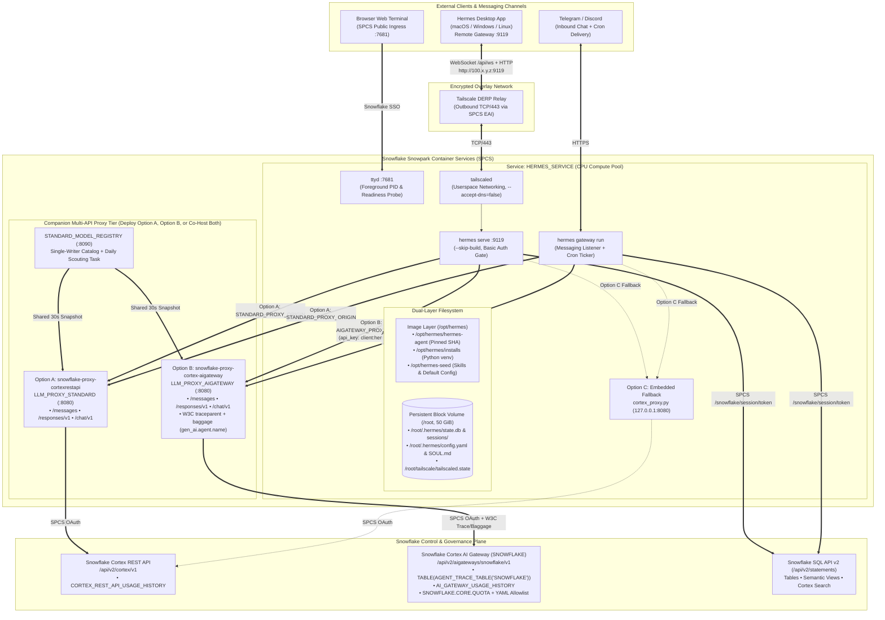
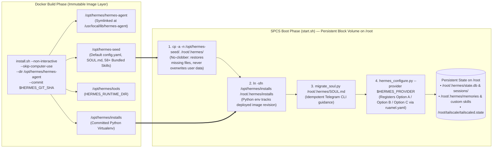
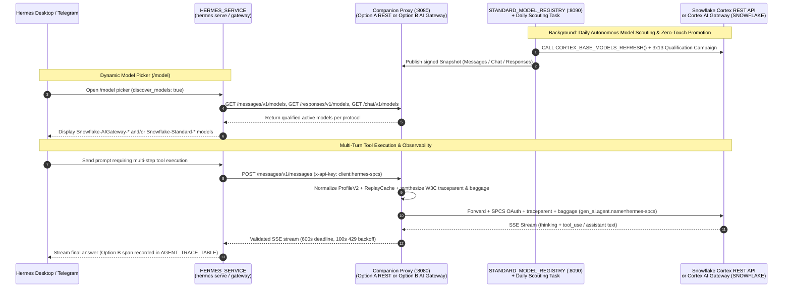
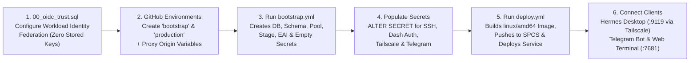

<div align="center">

# Hermes Agent on Snowflake (SPCS)

**Production-Grade Deployment of [Hermes Agent](https://hermes-agent.nousresearch.com) on Snowflake Snowpark Container Services (SPCS) with Multi-API Cortex REST API & Cortex AI Gateway Integration, Persistent Block Storage, Tailscale Remote Gateway & Passwordless GitHub OIDC**

[](LICENSE)
[](https://docs.snowflake.com/en/developer-guide/snowpark-container-services/overview)
[](https://github.com/fbattaglieri-snowflake/snowflake-proxy-cortexrestapi)
[](https://github.com/fbattaglieri-snowflake/snowflake-proxy-cortex-aigateway)
[](docs/client-setup.md)
[](#quickstart--local-validation)

</div>

---

> [!WARNING]
> ### IMPORTANT DISCLAIMER — NOT AN OFFICIAL SNOWFLAKE OR NOUSRESEARCH PRODUCT
> **This repository is an independent, open-source community and field-engineering reference implementation** developed and maintained by **Francesco Battaglieri** with the assistance of **Snowflake Cortex Code**.
> - It is **NOT an official release, product, service, or support offering** from **Snowflake Inc.** or **NousResearch Inc.** (authors of Hermes Agent).
> - Neither organization reviewed, approved, sponsored, endorsed, certified, or warranted this project.
> - It is provided strictly **"AS IS"** without warranty of any kind. See [DISCLAIMER.md](DISCLAIMER.md) and [LICENSE](LICENSE) for full terms.

> [!IMPORTANT]
> ### REQUIRED UPSTREAM PROXY CHOICE — DEPLOY **EITHER** CORTEX REST API PROXY **OR** CORTEX AI GATEWAY PROXY (OR BOTH)
> Standard OpenAI/Anthropic SDKs inside Hermes cannot call raw Snowflake Cortex endpoints directly without encountering OAuth token-rotation gaps, missing `GET /v1/models` catalogs (`HTTP 404`), parameter rejections (`max_tokens`, `store=true`, `thinking.type="enabled"`, `temperature` on Claude 5.x), and `>1 MiB` multi-turn payload limits.
>
> To unlock all **3 native API surfaces** (**Anthropic Messages** `/messages`, **OpenAI Responses** `/responses/v1`, and **OpenAI Chat Completions** `/chat/v1`) with dynamic model discovery (`discover_models: true`), `1,050,000`-token context windows, `32 MiB` payloads, `600s` compression deadlines, and `HTTP 429` exponential backoff, **you must deploy at least one of the two companion SPCS proxy services** (or co-host both on the same `CPU_X64_XS` compute pool sharing `STANDARD_MODEL_REGISTRY :8090`):
> - **Option A — Cortex REST API Proxy:** [**`fbattaglieri-snowflake/snowflake-proxy-cortexrestapi`**](https://github.com/fbattaglieri-snowflake/snowflake-proxy-cortexrestapi) $\rightarrow$ routes directly to [Snowflake Cortex REST API (`/api/v2/cortex/v1`)](https://docs.snowflake.com/en/user-guide/snowflake-cortex/cortex-llm-rest-api).
> - **Option B — Cortex AI Gateway Proxy (Enterprise Governance & OpenTelemetry):** [**`fbattaglieri-snowflake/snowflake-proxy-cortex-aigateway`**](https://github.com/fbattaglieri-snowflake/snowflake-proxy-cortex-aigateway) $\rightarrow$ routes through [Snowflake Cortex AI Gateway (`/api/v2/aigateways/snowflake/v1`)](https://docs.snowflake.com/en/user-guide/snowflake-cortex/cortex-ai-gateway) with native OpenTelemetry spans in [`TABLE(AGENT_TRACE_TABLE('SNOWFLAKE'))`](https://docs.snowflake.com/en/user-guide/snowflake-cortex/cortex-ai-gateway/observability), Snowsight Trace Analytics, per-user blocking quotas via [`SNOWFLAKE.CORE.QUOTA`](https://docs.snowflake.com/en/developer-guide/cortex-ai-cookbook/gateway-governance-quickstart/code), and YAML model allowlists.
> - **Model Qualification Harness:** [**`fbattaglieri-snowflake/cortex-model-compatibility-matrix`**](https://github.com/fbattaglieri-snowflake/cortex-model-compatibility-matrix)
> - **Option C — Embedded Single-Container Fallback:** `proxy/cortex_proxy.py` (`127.0.0.1:8080`) is also bundled inside the Hermes container for standalone Chat Completions-only testing without an external proxy service.

---

## Table of Contents

1. [Executive Overview & Why This Architecture Exists](#1-executive-overview--why-this-architecture-exists)
2. [End-to-End System Architecture (Mermaid & ASCII Schematics)](#2-end-to-end-system-architecture)
3. [Choosing Your Upstream: Cortex REST API Proxy vs. Cortex AI Gateway Proxy](#3-choosing-your-upstream-cortex-rest-api-proxy-vs-cortex-ai-gateway-proxy)
4. [Container Filesystem Layout & The `/root` Block Volume Seed Pattern](#4-container-filesystem-layout--the-root-block-volume-seed-pattern)
5. [Dynamic Model Discovery, Agent Attribution & Multi-Turn Inference Flow](#5-dynamic-model-discovery-agent-attribution--multi-turn-inference-flow)
6. [Self-Contained Synthetic Demo (`examples/snowflake-ops-copilot`)](#6-self-contained-synthetic-demo-examplessnowflake-ops-copilot)
7. [Prerequisites & Cross-Region Inference (`ANY_REGION`)](#7-prerequisites--cross-region-inference-any_region)
8. [Step-by-Step Deployment Guide (GitHub Actions OIDC)](#8-step-by-step-deployment-guide-github-actions-oidc)
9. [Repository Structure](#9-repository-structure)
10. [Quickstart & Local Validation](#quickstart--local-validation)
11. [Documentation Index](#documentation-index)

---

## 1. Executive Overview & Why This Architecture Exists

Running **Hermes Agent** inside **Snowflake Snowpark Container Services (SPCS)** — while connecting **Hermes Desktop** from any workstation, **Telegram / Discord** for mobile messaging and autonomous cron jobs, and **Snowflake Cortex AI** as the LLM and data backbone — solves four architectural challenges:

| # | Architectural Challenge | Root Cause in SPCS / Cortex | How `hermes-snowflake` Solves It |
|---|---|---|---|
| **1** | **Multi-API Protocol, OAuth & Rate-Limit Deviations** | SPCS requires a rotating `/snowflake/session/token` (`OAUTH`), neither Cortex REST API nor Cortex AI Gateway exposes `GET /v1/models`, and SDK defaults (`max_tokens`, `store=true`, `thinking.type="enabled"`, `>1 MiB` reasoning histories) fail on raw endpoints. | Connects Hermes to **Option A** ([`snowflake-proxy-cortexrestapi`](https://github.com/fbattaglieri-snowflake/snowflake-proxy-cortexrestapi)) **or Option B** ([`snowflake-proxy-cortex-aigateway`](https://github.com/fbattaglieri-snowflake/snowflake-proxy-cortex-aigateway)) across `/messages`, `/responses/v1`, and `/chat/v1` + ships `proxy/cortex_proxy.py` (`127.0.0.1:8080`) as a fallback. |
| **2** | **Hermes Desktop WebSocket Connectivity** | Snowflake public HTTP ingress consumes `Authorization`, enforces interactive SSO/PAT login, and breaks Hermes Desktop's `/api/ws` WebSocket ticket handshake on `:9119`. | Runs **Tailscale in userspace networking mode** (`--tun=userspace-networking`, `--accept-dns=false`) over outbound **DERP TCP/443**, giving Hermes Desktop a direct, stable tailnet IP (`http://100.x.y.z:9119`) across restarts. |
| **3** | **Block Volume Masking of `/root`** | Mounting a persistent SPCS block volume at `/root` masks everything written under `/root` at `docker build` time (skills, default `config.yaml`, Python environments). | Installs Hermes and Python virtualenvs in **`/opt/hermes`** (outside `/root`), snapshots default config/skills into **`/opt/hermes-seed`**, and restores missing files with `cp -a -n` (no-clobber) at every boot. |
| **4** | **Process & Cron Supervision Without `systemd`** | SPCS containers lack `systemd`, `hermes serve` hangs without `--skip-build`, and naive `pgrep -f "hermes gateway run"` fails when the Python launcher rewrites `argv[0]`. | `start.sh` verifies recorded PID + `/proc/<pid>/cmdline` identity (`gateway.pid`), checks upstream `/healthz`, and supervises `hermes gateway run`, `tailscaled`, and `hermes serve --skip-build` while keeping `ttyd :7681` in the foreground. |

---

## 2. End-to-End System Architecture



### ASCII Architecture Quick-Reference

```text
+---------------------------------------------------------------------------------------------------+
|  EXTERNAL CLIENTS                                                                                 |
|  • Hermes Desktop (Windows/macOS/Linux) ──> Tailscale DERP (TCP/443) ──> http://100.x.y.z:9119    |
|  • Telegram / Discord + Cron Delivery   ──> Outbound HTTPS (TCP/443) ──> hermes gateway run       |
|  • Browser Web Terminal                 ──> SPCS Public Ingress      ──> ttyd (:7681)             |
+-------------------------------------------------+-------------------------------------------------+
                                                  |
                                                  v
+---------------------------------------------------------------------------------------------------+
|  SPCS CONTAINER: HERMES_SERVICE (50 GiB Persistent Block Volume at /root + /opt/hermes Image)     |
|  • /root/.hermes/config.yaml patched idempotently by /opt/hermes_configure.py (ruamel.yaml)       |
|  • Dynamic discovery (discover_models: true) across Messages, Responses (1.05M ctx), and Chat     |
+------------------------+-------------------------------------------------+------------------------+
                         |                                                 |
       Option A (Direct Cortex REST API)                 Option B (Cortex AI Gateway + OTel)
                         |                                                 |
                         v                                                 v
+------------------------------------------------+ +------------------------------------------------+
| snowflake-proxy-cortexrestapi (:8080)          | | snowflake-proxy-cortex-aigateway (:8080)       |
| • STANDARD_PROXY_ORIGIN                        | | • AIGATEWAY_PROXY_ORIGIN                       |
| • ProfileV2 + OrderedItems SSE + ReplayCache   | | • Same ProfileV2 + OrderedItems + ReplayCache  |
| • 32 MiB Body / 600s Deadline / 429 Backoff    | | • Auto W3C traceparent + baggage (hermes-spcs) |
+------------------------+-----------------------+ +-----------------------+------------------------+
                         |           (Both can share one                   |
                         |        STANDARD_MODEL_REGISTRY :8090)           |
                         v                                                 v
+------------------------------------------------+ +------------------------------------------------+
| Snowflake Cortex REST API                      | | Snowflake Cortex AI Gateway (SNOWFLAKE)        |
| https://<host>/api/v2/cortex/v1                | | https://<host>/api/v2/aigateways/snowflake/v1  |
| • Metered in CORTEX_REST_API_USAGE_HISTORY     | | • Spans in TABLE(AGENT_TRACE_TABLE('SNOWFLAKE'))|
| • Supports unreleased PrPr Voltron models      | | • Metered in AI_GATEWAY_USAGE_HISTORY          |
|                                                | | • Per-user blocking SNOWFLAKE.CORE.QUOTA       |
+------------------------------------------------+ +------------------------------------------------+
```

---

## 3. Choosing Your Upstream: Cortex REST API Proxy vs. Cortex AI Gateway Proxy

Deploy **either** Option A **or** Option B (or co-host both on the same `CPU_X64_XS` compute pool at zero extra Snowflake credit cost by sharing a single `STANDARD_MODEL_REGISTRY :8090` instance).

| Dimension | Option A: Cortex REST API Proxy ([`snowflake-proxy-cortexrestapi`](https://github.com/fbattaglieri-snowflake/snowflake-proxy-cortexrestapi)) | Option B: Cortex AI Gateway Proxy ([`snowflake-proxy-cortex-aigateway`](https://github.com/fbattaglieri-snowflake/snowflake-proxy-cortex-aigateway)) |
|---|---|---|
| **Snowflake Upstream Endpoint** | `https://<host>/api/v2/cortex/v1` ([Docs](https://docs.snowflake.com/en/user-guide/snowflake-cortex/cortex-llm-rest-api)) | `https://<host>/api/v2/aigateways/snowflake/v1` ([Docs](https://docs.snowflake.com/en/user-guide/snowflake-cortex/cortex-ai-gateway)) |
| **Hermes Env Var & Provider Slugs** | `STANDARD_PROXY_ORIGIN`<br/>`snowflake-standard-{messages,responses,chat}` | `AIGATEWAY_PROXY_ORIGIN`<br/>`snowflake-aigateway-{messages,responses,chat}` |
| **Why the Proxy Layer is Still Required** | Adds `GET /<proto>/v1/models`, SPCS `/snowflake/session/token` OAuth injection, `ProfileV2` parameter normalization, `OrderedItems` SSE, `ReplayCache`, `32 MiB` body, `600s` deadline, and `HTTP 429` backoff. | **Identical proxy guarantees** — Cortex AI Gateway alone also returns `HTTP 404` on `GET /v1/models` and does not normalize client SDK parameter quirks. |
| **OpenTelemetry Traces & Prompt Capture** | Proxy structural metrics only (no Snowflake trace table). | Native spans in [`TABLE(AGENT_TRACE_TABLE('SNOWFLAKE'))`](https://docs.snowflake.com/en/user-guide/snowflake-cortex/cortex-ai-gateway/observability) + Snowsight [Trace Analytics](https://docs.snowflake.com/en/user-guide/snowflake-cortex/cortex-ai-gateway/observability/trace-analytics) (`Models`, `Reliability`, `Tools`, `Sessions`). |
| **Zero-Touch Agent Attribution** | N/A | `hermes_configure.py` sets `api_key: "client:hermes-spcs"`; the proxy strips the dummy key and injects W3C `traceparent`, `snow-agent-name: hermes-spcs`, and W3C `baggage` (`gen_ai.agent.id=hermes-spcs,gen_ai.agent.name=hermes-spcs`). |
| **Billing & Usage Attribution View** | `SNOWFLAKE.ACCOUNT_USAGE.CORTEX_REST_API_USAGE_HISTORY` | `SNOWFLAKE.ACCOUNT_USAGE.AI_GATEWAY_USAGE_HISTORY` (`CREDITS_GRANULAR` per user & model) |
| **Central Model Allowlist & Blocking Quotas** | Enforced by signed `STANDARD_MODEL_REGISTRY` catalog + `SNOWFLAKE.CORTEX_USER`. | Registry catalog **plus** `ALTER AI GATEWAY SNOWFLAKE FROM SPECIFICATION` YAML `models:` allowlist **plus** blocking per-user spend caps via [`SNOWFLAKE.CORE.QUOTA`](https://docs.snowflake.com/en/developer-guide/cortex-ai-cookbook/gateway-governance-quickstart/code) (`ADD_SHARED_RESOURCE('AI GATEWAY')`). |
| **Model Catalog Eligibility** | Serves all GA, Preview, **and** early PrPr models even before they appear in `SNOWFLAKE.MODELS`. | Requires the model object to exist in `SNOWFLAKE.MODELS` (`SHOW MODELS IN ACCOUNT`) and match the Gateway `models:` allowlist. |

### Enabling Cortex AI Gateway Observability (Option B)

```sql
USE ROLE ACCOUNTADMIN;

-- Inspect current specification first (FROM SPECIFICATION replaces the whole spec):
DESCRIBE AI GATEWAY SNOWFLAKE;

-- Enable OpenTelemetry trace logging (and optional prompt/response capture):
ALTER AI GATEWAY SNOWFLAKE FROM SPECIFICATION $$
schema_version: 1
models:
  - name: '*'
logging:
  enabled: true
  enable_client_telemetry: true
  capture_payload:
    request_response: true
$$;
```

Query live Hermes turns in `AGENT_TRACE_TABLE('SNOWFLAKE')`:

```sql
SELECT
  start_timestamp,
  trace:"trace_id"::STRING                                              AS trace_id,
  record:"name"::STRING                                                 AS span_name,
  record_attributes:"gen_ai.agent.name"::STRING                         AS agent_name,
  record_attributes:"gen_ai.request.model"::STRING                      AS model,
  TRY_TO_NUMBER(record_attributes:"http.status_code"::STRING)           AS http_status,
  TRY_TO_NUMBER(record_attributes:"gen_ai.usage.input_tokens"::STRING)  AS input_tokens,
  TRY_TO_NUMBER(record_attributes:"gen_ai.usage.output_tokens"::STRING) AS output_tokens,
  DATEDIFF('millisecond', start_timestamp, timestamp)                   AS duration_ms
FROM TABLE(AGENT_TRACE_TABLE('SNOWFLAKE'))
WHERE timestamp >= DATEADD('hour', -2, CURRENT_TIMESTAMP())
  AND COALESCE(
        record_attributes:"gen_ai.agent.name"::STRING,
        record_attributes:"http.request.header.snow-agent-name"::STRING
      ) = 'hermes-spcs'
ORDER BY start_timestamp DESC
LIMIT 50;
```

---

## 4. Container Filesystem Layout & The `/root` Block Volume Seed Pattern

In SPCS, mounting a persistent block volume at `/root` **masks everything written under `/root` during `docker build`**. Conversely, anything outside `/root` resets whenever SPCS reschedules or upgrades the container.

`docker/hermes/Dockerfile` and `docker/hermes/start.sh` separate **immutable versioned code** (`/opt/hermes`) from **persistent user state** (`/root`):



> [!CAUTION]
> **Never run `hermes update` or `curl -fsSL https://hermes-agent.nousresearch.com/install.sh | bash` inside a running SPCS container.**
> To upgrade Hermes Agent to a newer upstream commit, update `ARG HERMES_GIT_SHA` in `docker/hermes/Dockerfile`, build a new image, and roll it out via `ALTER SERVICE` (see [docs/operations.md](docs/operations.md)).

---

## 5. Dynamic Model Discovery, Agent Attribution & Multi-Turn Inference Flow



---

## 6. Self-Contained Synthetic Demo (`examples/snowflake-ops-copilot`)

External readers do **not** need access to any pre-existing Snowflake tables or private workflows. [`examples/snowflake-ops-copilot/`](examples/snowflake-ops-copilot/) provides a complete, out-of-the-box example with idempotent SQL setup scripts:

- **`sql/00_role_and_grants.sql`** — Creates `HERMES_DEMO_WH`, `HERMES_DEMO.OPS`, and least-privilege role **`HERMES_DEMO_ROLE`** (`SNOWFLAKE.CORTEX_USER` + `USAGE`/`MONITOR` on `AI GATEWAY SNOWFLAKE`).
- **`sql/10_objects.sql`** — Creates synthetic `SERVICE_INCIDENTS` and `RUNBOOK_ARTICLES` tables, governed Semantic View `INCIDENT_ANALYTICS` (for Cortex Analyst), and Cortex Search service `RUNBOOK_SEARCH_SVC`.
- **`sql/20_seed.sql`** — Idempotently seeds synthetic incident telemetry and remediation runbooks via `MERGE`.
- **`skill/SKILL.md`** — Drop-in Hermes Agent Skill (`/root/.hermes/skills/snowflake-ops-copilot/SKILL.md`) using the container's rotating `/snowflake/session/token` against `/api/v2/statements`.

---

## 7. Prerequisites & Cross-Region Inference (`ANY_REGION`)

### 7.1 Enable Snowflake Cross-Region Inference (`ANY_REGION`)

```sql
SHOW PARAMETERS LIKE 'CORTEX_ENABLED_CROSS_REGION' IN ACCOUNT;

-- With ACCOUNTADMIN privileges:
ALTER ACCOUNT SET CORTEX_ENABLED_CROSS_REGION = 'ANY_REGION';
```

### 7.2 Platform Prerequisites

1. **Snowflake Account with SPCS Enabled:** Verify `SHOW COMPUTE POOLS` and check valid `INSTANCE_FAMILY` values for your cloud region ([`CREATE COMPUTE POOL` docs](https://docs.snowflake.com/en/sql-reference/sql/create-compute-pool)).
2. **Companion Multi-API Proxy (Required for Full 3-API Operation):** Deploy **either** [**`snowflake-proxy-cortexrestapi`**](https://github.com/fbattaglieri-snowflake/snowflake-proxy-cortexrestapi) (`STANDARD_PROXY_ORIGIN`) **or** [**`snowflake-proxy-cortex-aigateway`**](https://github.com/fbattaglieri-snowflake/snowflake-proxy-cortex-aigateway) (`AIGATEWAY_PROXY_ORIGIN`), or co-host both.
3. **Tailscale Account (for Hermes Desktop):** Create a **reusable, non-ephemeral** auth key (`tskey-auth-...`) in the Tailscale Admin Console.
4. **GitHub Repository with Actions Enabled:** Used by the passwordless OIDC workflows (`.github/workflows/`).

---

## 8. Step-by-Step Deployment Guide (GitHub Actions OIDC)



1. **Fork or clone this repository.**
2. **Configure OIDC Trust in Snowflake:** Run `infrastructure/sql/00_oidc_trust.sql` once as `ACCOUNTADMIN`.
3. **Configure GitHub Environments & Variables:** Create `bootstrap` and `production` environments and configure the variables listed in [docs/configuration.md](docs/configuration.md) (setting `AIGATEWAY_PROXY_ORIGIN`, `STANDARD_PROXY_ORIGIN`, or both).
4. **Run `Bootstrap Snowflake` (`bootstrap.yml`):** Creates the database, schema, warehouse, compute pool, image repository, stage, EAI, placeholder Snowflake Secrets, and `SNOWFLAKE.CORTEX_USER` grant.
5. **Populate Snowflake Secrets:** Populate `HERMES_SSH_PUBKEY`, `HERMES_DASH_USERNAME`, `HERMES_DASH_PASSWORD_HASH`, `HERMES_DASH_SECRET`, `TS_AUTHKEY`, and optional `TELEGRAM_BOT_TOKEN` / `TELEGRAM_HOME_CHANNEL` (see [docs/configuration.md](docs/configuration.md)).
6. **Run `Deploy to Snowflake` (`deploy.yml`):** Builds the reproducible `linux/amd64` image, pushes it to SPCS, stages `hermes.service.yaml`, and updates `HERMES_SERVICE` without dropping the persistent block volume.
7. **Connect Hermes Desktop & Run the Synthetic Demo:** Follow [docs/client-setup.md](docs/client-setup.md) and [`examples/snowflake-ops-copilot/`](examples/snowflake-ops-copilot/).

---

## 9. Repository Structure

```text
hermes-snowflake/
├── LICENSE / DISCLAIMER.md / NOTICE / SECURITY.md / CONTRIBUTING.md / SUPPORT.md
├── docker/hermes/
│   ├── Dockerfile                           # Reproducible Ubuntu 24.04 image (/opt/hermes + /opt/hermes-seed)
│   ├── start.sh                             # Boot entrypoint, seed restore, PID-verified watchdogs & self-tests
│   ├── hermes_configure.py                  # Idempotent ruamel.yaml patcher (Option A REST + Option B AI Gateway + Option C)
│   ├── migrate_soul.py                      # Safe, atomic SOUL.md Telegram instruction migrator
│   ├── spcs_token.sh                        # Rotating SPCS OAuth token helper (JSON with 120s TTL)
│   └── README.md                            # Container internals and environment variable reference
├── examples/snowflake-ops-copilot/          # Self-contained synthetic Snowflake demo (no maintainer account needed)
│   ├── README.md                            # Architecture & step-by-step setup guide
│   ├── sql/00_role_and_grants.sql           # Least-privilege HERMES_DEMO_ROLE + Cortex & AI Gateway grants
│   ├── sql/10_objects.sql                   # Synthetic tables, Semantic View & Cortex Search service
│   ├── sql/20_seed.sql                      # Idempotent MERGE seed data (incidents & runbooks)
│   └── skill/SKILL.md                       # Drop-in Hermes Agent Skill using /snowflake/session/token
├── infrastructure/
│   ├── specs/hermes.service.yaml            # Parameterized SPCS service spec (50Gi block volume + secrets)
│   └── sql/{00_oidc_trust,10_bootstrap,20_deploy,30_verify}.sql
├── proxy/
│   ├── cortex_proxy.py                      # Option C: Embedded zero-dependency fallback proxy (127.0.0.1:8080)
│   ├── models.json                          # Fallback model catalog & tool-calling constraints
│   └── test_{proxy,model_gate,configure_and_soul}.py
├── tooling/
│   └── {cortex_model_gate,refresh_cortex_models,cortex_wire_check}.py
├── scripts/validate.sh                      # Local & CI validation suite (py_compile, ruff, pytest, yamllint)
├── .github/{dependabot.yml,workflows/*.yml} # CI (validate, gitleaks, trivy, build) + OIDC lifecycle workflows
└── docs/                                    # Architecture, configuration, client setup, model management & runbooks
```

---

## Quickstart & Local Validation

Requirements: Python 3.11+, `pytest`, `ruff`, and `yamllint`. All **46 unit tests** run completely offline without Snowflake credentials or network access:

```bash
git clone https://github.com/fbattaglieri-snowflake/hermes-snowflake.git
cd hermes-snowflake
python3 -m venv .venv
.venv/bin/pip install pytest ruff yamllint
PATH=".venv/bin:$PATH" ./scripts/validate.sh
```

### Build the Container Image Locally (`linux/amd64`)

```bash
docker build --platform linux/amd64 -f docker/hermes/Dockerfile -t hermes-snowflake:latest .
```

---

## Documentation Index

| Document | Topics Covered |
|---|---|
| [**Architecture (`docs/architecture.md`)**](docs/architecture.md) | Process supervision, `/opt/hermes` vs `/root` block storage, Tailscale DERP networking, and Option A (`snowflake-proxy-cortexrestapi`) vs Option B (`snowflake-proxy-cortex-aigateway`) topologies. |
| [**Configuration (`docs/configuration.md`)**](docs/configuration.md) | GitHub OIDC variables (`STANDARD_PROXY_ORIGIN`, `AIGATEWAY_PROXY_ORIGIN`, `HERMES_PROVIDER`, `HERMES_MODEL`), container env vars, and Snowflake Secrets. |
| [**Model Management (`docs/model-management.md`)**](docs/model-management.md) | Zero-touch promotion across Cortex REST API & Cortex AI Gateway (`CORTEX_BASE_MODELS_REFRESH()`, `ALTER AI GATEWAY`), plus the 4-gate fallback workflow. |
| [**Synthetic Example (`examples/snowflake-ops-copilot/README.md`)**](examples/snowflake-ops-copilot/README.md) | Self-contained SQL setup (`HERMES_DEMO_ROLE` + synthetic tables + Semantic View + Cortex Search) and drop-in Hermes Skill. |
| [**Client Setup (`docs/client-setup.md`)**](docs/client-setup.md) | Connecting **Hermes Desktop** (`:9119`) over Tailscale on macOS, Windows, and Linux. |
| [**Motivation & Cortex Deviations (`docs/motivation.md`)**](docs/motivation.md) | Wire-level deviations in raw Cortex Chat Completions and how proxy normalization resolves them. |
| [**Operations (`docs/operations.md`)**](docs/operations.md) | Safe image upgrades (`HERMES_GIT_SHA`), why in-container `hermes update` must never be run, suspend/resume order, and cronjob spend-guard pinning. |
| [**Backup & Recovery (`docs/backup-recovery.md`)**](docs/backup-recovery.md) | SPCS block volume snapshots (`CREATE SNAPSHOT`), manual `.hermes` stage archives, and disaster recovery scenarios. |
| [**Security (`docs/security.md`)**](docs/security.md) | Threat model, GitHub OIDC federation, scrypt dashboard authentication, and loopback/tailnet isolation. |
| [**Troubleshooting (`docs/troubleshooting.md`)**](docs/troubleshooting.md) | SPCS, Tailscale userspace networking, WebSocket close codes, `HTTP 413` / `/compress` tuning, and `HTTP 429` exponential backoff. |

---

## Official Snowflake Documentation References

- [Snowpark Container Services (SPCS) Overview](https://docs.snowflake.com/en/developer-guide/snowpark-container-services/overview)
- [Snowflake Cortex LLM REST API (`/api/v2/cortex/v1`)](https://docs.snowflake.com/en/user-guide/snowflake-cortex/cortex-llm-rest-api)
- [Snowflake Cortex AI Gateway Overview (`/api/v2/aigateways/snowflake/v1`)](https://docs.snowflake.com/en/user-guide/snowflake-cortex/cortex-ai-gateway)
- [Observability for Cortex AI Gateway (`AGENT_TRACE_TABLE` & W3C `baggage`)](https://docs.snowflake.com/en/user-guide/snowflake-cortex/cortex-ai-gateway/observability)
- [Trace Analytics for Cortex AI Gateway](https://docs.snowflake.com/en/user-guide/snowflake-cortex/cortex-ai-gateway/observability/trace-analytics)
- [Cortex AI Gateway Governance & Per-User Quotas (`SNOWFLAKE.CORE.QUOTA`)](https://docs.snowflake.com/en/developer-guide/cortex-ai-cookbook/gateway-governance-quickstart/code)

---

## License

Repository-authored code and documentation are licensed under the **[Apache License 2.0](LICENSE)**. Hermes Agent and all upstream dependencies retain their respective licenses. Always review [DISCLAIMER.md](DISCLAIMER.md) and [NOTICE](NOTICE) before using or redistributing this project.
