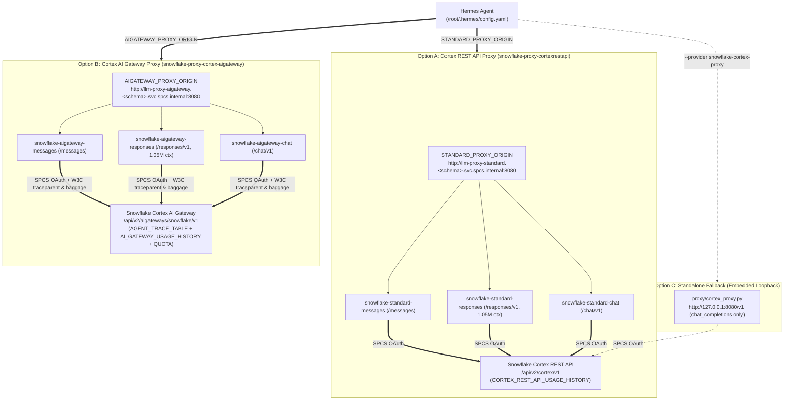

# Architecture

> [!NOTE]
> See [README.md](../README.md) for the end-to-end schematic. This document details internal container process supervision, dual-layer storage (`/opt/hermes` vs. `/root`), Tailscale Desktop networking, and the **three supported Snowflake Cortex upstream topologies** (**Option A: Cortex REST API Proxy**, **Option B: Cortex AI Gateway Proxy**, and **Option C: Embedded Loopback Fallback**).

---

## 1. Container Process Supervision (`start.sh`)

SPCS containers do not run `systemd`. `docker/hermes/start.sh` boots every daemon in dependency order, attaches background watchdog loops to critical services, and keeps `ttyd` as the foreground PID (`readinessProbe` and `livenessProbe` target on port `7681`).

```mermaid
flowchart LR
    BOOT(["Container Boot<br/>(/start.sh)"]) --> SSH["1. sshd (:22)<br/>Inject SSH_PUBLIC_KEY"]
    SSH --> SEED["2. Storage Seed & Link<br/>• cp -a -n /opt/hermes-seed/. /root/.hermes/<br/>• ln -sfn /opt/hermes/installs /root/.hermes/installs"]
    SEED --> CFG["3. Config & SOUL Patch<br/>• migrate_soul.py<br/>• hermes_configure.py (Option A / B / C)"]
    CFG --> PROXY["4. Embedded Fallback Proxy<br/>cortex_proxy.py (127.0.0.1:8080)<br/>+ 30s Watchdog"]
    PROXY --> CF["5. Cloudflare Tunnel<br/>(Optional, HTTP/2)"]
    CF --> GW["6. hermes gateway run<br/>(Upstream /healthz + gateway.pid Watchdog)"]
    GW --> TS["7. tailscaled + hermes serve (:9119)<br/>(Userspace Networking + --skip-build)<br/>+ 60s /api/status Watchdog"]
    TS --> TTYD["8. exec ttyd (:7681)<br/>(Foreground Process & Health Probe)"]
```

| Process | Bind / Port | Role & Supervision |
|---|---|---|
| **`ttyd`** | `0.0.0.0:7681` | Web terminal, `exec` foreground process, and SPCS `readinessProbe` / `livenessProbe` target. |
| **`hermes serve`** | `0.0.0.0:9119` | Remote gateway backend for **Hermes Desktop** and remote CLI. Launched with `--skip-build` and supervised by a 60s watchdog polling `GET /api/status`. |
| **`hermes gateway run`** | Outbound HTTPS | Listens to messaging platforms (Telegram/Discord) **and** acts as the cron scheduler ticker. Verified via `/root/.hermes/gateway.pid` + `/proc/<pid>/cmdline` (`['gateway', 'run']`) so Python launcher `argv[0]` rewrites never trigger false-negative restarts. |
| **`tailscaled`** | `/root/tailscale/sock` | Tailscale daemon running in `--tun=userspace-networking` mode (`--accept-dns=false`). Persists node identity in `/root/tailscale/tailscaled.state`. |
| **`cortex_proxy.py`** | `127.0.0.1:8080` | Embedded zero-dependency fallback proxy for single-container Chat Completions. Supervised by a 30s health watchdog. |
| **`sshd`** | `0.0.0.0:22` | Optional SSH fallback access authorized via the `HERMES_SSH_PUBKEY` Snowflake Secret. |
| **`cloudflared`** | Outbound HTTP/2 | Optional Cloudflare tunnel (`--protocol http2`) configured via `CF_TUNNEL_TOKEN`. |

---

## 2. Block Storage & The `/root` Seed Pattern

SPCS mounts a persistent block volume (`50Gi`, `SNOWFLAKE_FULL` encryption) at `/root` at runtime, masking all image content under `/root`.

1. **Code & Python Environments Live Outside `/root` (`/opt/hermes`):**
   - `docker/hermes/Dockerfile` installs Hermes with `HERMES_HOME=/opt/hermes` into `/opt/hermes/hermes-agent` (pinned to `ARG HERMES_GIT_SHA`, symlinked at `/usr/local/lib/hermes-agent`) and `/opt/hermes/installs` (`HERMES_RUNTIME_DIR=/opt/hermes/tools`).
   - At every boot, `start.sh` links `/opt/hermes/installs` to `/root/.hermes/installs`.
2. **Default Config & Bundled Skills Are Seeded via `/opt/hermes-seed`:**
   - At build time, `Dockerfile` archives initial `config.yaml`, `.env`, `SOUL.md`, and 58+ bundled skills into `/opt/hermes-seed`.
   - At boot time, `start.sh` runs `cp -a -n /opt/hermes-seed/. /root/.hermes/` (`no-clobber`), restoring missing seed files without overwriting `state.db`, memories, custom skills, or user edits.

---

## 3. Client Connectivity (Tailscale Userspace Networking)

Hermes Desktop connects to `hermes serve` over REST (`/api/status`, `/auth/password-login`) and WebSocket (`/api/ws?ticket=...`).

- **Why SPCS Public Ingress Cannot Host `:9119` Directly:** Snowflake's public ingress consumes the `Authorization` header, enforces interactive SSO/PAT login, and blocks Hermes Desktop's WebSocket upgrade handshake.
- **How Tailscale Solves It:** `tailscaled` runs in `--tun=userspace-networking` mode over outbound **DERP TCP/443** (`HERMES_EGRESS_EAI`) with `--accept-dns=false` so internal `*.svc.spcs.internal` DNS continues to resolve. Persisting `/root/tailscale/tailscaled.state` keeps the exact same `100.x.y.z` tailnet IP across restarts.

---

## 4. Upstream Proxy Topologies: Option A vs. Option B vs. Option C

To run Hermes with all three native protocols (`Messages`, `Responses`, and `Chat Completions`) and dynamic model discovery, deploy **either Option A or Option B** (or co-host both sharing a single `STANDARD_MODEL_REGISTRY :8090` on the same `CPU_X64_XS` compute pool):

### Architectural Differences Between Option A and Option B

1. **Option A — [`snowflake-proxy-cortexrestapi`](https://github.com/fbattaglieri-snowflake/snowflake-proxy-cortexrestapi):**
   - Forwards normalized requests directly to [Snowflake Cortex REST API (`/api/v2/cortex/v1`)](https://docs.snowflake.com/en/user-guide/snowflake-cortex/cortex-llm-rest-api).
   - Metered in `SNOWFLAKE.ACCOUNT_USAGE.CORTEX_REST_API_USAGE_HISTORY`.
   - Ideal when you want minimal setup or need access to early PrPr models before they are published as objects in `SNOWFLAKE.MODELS`.
2. **Option B — [`snowflake-proxy-cortex-aigateway`](https://github.com/fbattaglieri-snowflake/snowflake-proxy-cortex-aigateway):**
   - Forwards normalized requests to [Snowflake Cortex AI Gateway (`/api/v2/aigateways/snowflake/v1`)](https://docs.snowflake.com/en/user-guide/snowflake-cortex/cortex-ai-gateway).
   - **OpenTelemetry & Snowsight Trace Analytics:** Every inference turn is recorded in [`TABLE(AGENT_TRACE_TABLE('SNOWFLAKE'))`](https://docs.snowflake.com/en/user-guide/snowflake-cortex/cortex-ai-gateway/observability). Because `hermes_configure.py` sets `api_key: "client:hermes-spcs"`, the proxy automatically synthesizes W3C `traceparent` headers when omitted and injects both `snow-agent-name: hermes-spcs` and W3C `baggage` (`gen_ai.agent.id=hermes-spcs,gen_ai.agent.name=hermes-spcs`), populating Snowsight's **AI Gateway > Observability > Analytics** views automatically.
   - **Enterprise Governance & Blocking Quotas:** Enforces `ALTER AI GATEWAY SNOWFLAKE FROM SPECIFICATION` YAML `models:` allowlists, attributes per-user/per-model spend in `SNOWFLAKE.ACCOUNT_USAGE.AI_GATEWAY_USAGE_HISTORY`, and supports blocking daily/monthly per-user credit limits via [`SNOWFLAKE.CORE.QUOTA`](https://docs.snowflake.com/en/developer-guide/cortex-ai-cookbook/gateway-governance-quickstart/code) (`ADD_SHARED_RESOURCE('AI GATEWAY')`).
   - *SPCS Client-Span OTLP Note:* Server-side inference spans are captured automatically over internal SPCS OAuth (`/snowflake/session/token`). Exporting custom client-side OTLP spans directly to `<public-gateway-endpoint>/telemetry/v1/traces` requires an external ingress PAT (`Authorization: Bearer <PAT>`) because internal SPCS Envoy only mounts `/api/v2/aigateways/<gw>/v1/*`.
3. **Option C — Embedded Single-Container Fallback (`proxy/cortex_proxy.py`):**
   - Activated with `HERMES_PROVIDER=snowflake-cortex-proxy` when neither external proxy is deployed. Serves static `proxy/models.json` on `127.0.0.1:8080/v1` and handles Chat Completions only (including bounded `HTTP 429`/`503`/`529` exponential backoff).

---

## 5. Suspend & Resume Dependency Order

- **Suspend:** Suspend `HERMES_SERVICE` first, then suspend the compute pool.
- **Resume:** Resume the compute pool first, then resume `HERMES_SERVICE`.
