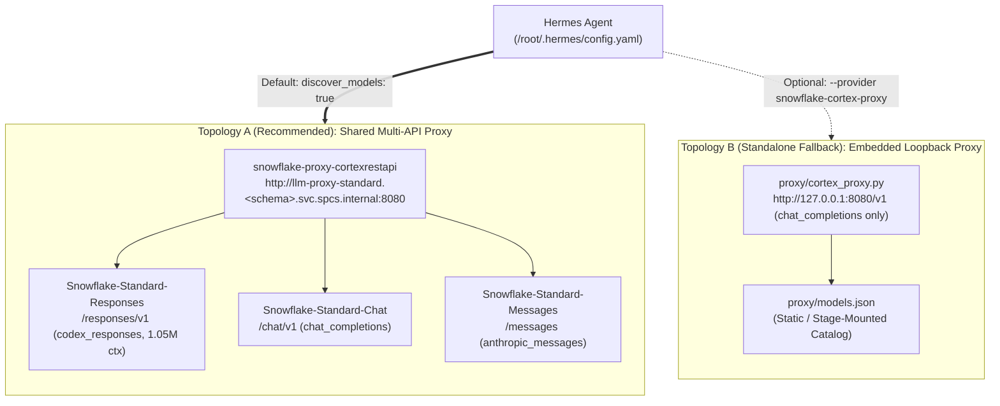

# Architecture

> [!NOTE]
> See the main [README.md](../README.md) for the high-level system schematic. This document details internal container supervision, dual-layer storage (`/opt/hermes` vs. `/root`), client networking, and the two supported Cortex proxy topologies.

---

## 1. Container Process Supervision (`start.sh`)

SPCS containers do not run `systemd`. `docker/hermes/start.sh` boots every required daemon in dependency order, attaches background watchdog loops to critical services, and keeps `ttyd` as the foreground PID (`readinessProbe` and `livenessProbe` target on port `7681`).

```mermaid
flowchart LR
    BOOT(["Container Boot<br/>(/start.sh)"]) --> SSH["1. sshd (:22)<br/>Inject SSH_PUBLIC_KEY"]
    SSH --> SEED["2. Storage Seed & Link<br/>• cp -a -n /opt/hermes-seed/. /root/.hermes/<br/>• ln -sfn /opt/hermes/installs /root/.hermes/installs"]
    SEED --> CFG["3. Config & SOUL Patch<br/>• migrate_soul.py<br/>• hermes_configure.py"]
    CFG --> PROXY["4. Embedded Fallback Proxy<br/>cortex_proxy.py (127.0.0.1:8080)<br/>+ 30s Watchdog"]
    PROXY --> CF["5. Cloudflare Tunnel<br/>(Optional, HTTP/2)"]
    CF --> GW["6. hermes gateway run<br/>(Telegram + Cron Ticker)<br/>+ 60s Watchdog"]
    GW --> TS["7. tailscaled + hermes serve (:9119)<br/>(Userspace Networking + --skip-build)<br/>+ 60s Watchdog"]
    TS --> TTYD["8. exec ttyd (:7681)<br/>(Foreground Process & Health Probe)"]
```

| Process | Bind / Port | Role & Supervision |
|---|---|---|
| **`ttyd`** | `0.0.0.0:7681` | Web terminal, `exec` foreground process, and SPCS `readinessProbe` / `livenessProbe` target. If it exits, the container exits. |
| **`hermes serve`** | `0.0.0.0:9119` | Remote gateway backend for **Hermes Desktop** and remote CLI. Launched with `--skip-build` and supervised by a 60s watchdog polling `GET /api/status`. |
| **`hermes gateway run`** | Outbound HTTPS | Listens to messaging platforms (Telegram/Discord) **and** acts as the cron scheduler ticker. Supervised by a 60s `pgrep` watchdog. |
| **`tailscaled`** | `/root/tailscale/sock` | Tailscale daemon running in `--tun=userspace-networking` mode (`--accept-dns=false`). Persists node identity in `/root/tailscale/tailscaled.state`. |
| **`cortex_proxy.py`** | `127.0.0.1:8080` | Embedded zero-dependency fallback proxy for single-container Chat Completions. Supervised by a 30s health watchdog. |
| **`sshd`** | `0.0.0.0:22` | Optional SSH fallback access authorized via the `HERMES_SSH_PUBKEY` Snowflake Secret. |
| **`cloudflared`** | Outbound HTTP/2 | Optional Cloudflare tunnel (`--protocol http2`) configured via `CF_TUNNEL_TOKEN`. |

---

## 2. Block Storage & The `/root` Seed Pattern

SPCS mounts a persistent block volume (`50Gi`, `SNOWFLAKE_FULL` encryption) at `/root` at runtime. This mount **masks all image content under `/root`**.

To ensure both **reproducible image upgrades** and **zero loss of user state**:

1. **Code & Python Environments Live Outside `/root` (`/opt/hermes`):**
   - `docker/hermes/Dockerfile` installs Hermes with `HERMES_HOME=/opt/hermes` into `/opt/hermes/hermes-agent` (pinned to `ARG HERMES_GIT_SHA`, symlinked at `/usr/local/lib/hermes-agent`) and `/opt/hermes/installs` (with `HERMES_RUNTIME_DIR=/opt/hermes/tools`).
   - At every boot, `start.sh` links `/opt/hermes/installs` to `/root/.hermes/installs`, so the Python environment automatically follows the deployed container image revision.
2. **Default Config & Bundled Skills Are Seeded via `/opt/hermes-seed`:**
   - At build time, `Dockerfile` archives the initial `config.yaml`, `.env`, `SOUL.md`, and 58+ bundled skills into `/opt/hermes-seed` (excluding `hermes-agent`, `installs`, `tools`, `cache`, `logs`, `telemetry`, and `backups`).
   - At boot time, `start.sh` runs `cp -a -n /opt/hermes-seed/. /root/.hermes/` (`no-clobber`), restoring any missing seed files without overwriting existing sessions (`state.db`), memories, custom skills, or user edits.

---

## 3. Client Connectivity (Why Tailscale Instead of SPCS Public Ingress?)

The Hermes Desktop application connects to `hermes serve` over a combination of REST (`/api/status`, `/auth/password-login`) and WebSocket (`/api/ws?ticket=...`) requests.

- **Why SPCS Public Ingress Cannot Host `:9119` Directly:** Snowflake's public ingress consumes the `Authorization` header, enforces Snowflake interactive SSO or PAT authentication, and does not pass Hermes Desktop's unauthenticated WebSocket upgrade handshake.
- **How Tailscale Userspace Networking Solves It:**
  - `tailscaled` runs in `--tun=userspace-networking` mode (requiring no `/dev/net/tun` device and no `NET_ADMIN` kernel capability) and connects outbound over **DERP TCP/443**, which passes cleanly through `HERMES_EGRESS_EAI`.
  - `--accept-dns=false` prevents Tailscale from overwriting `/etc/resolv.conf`, ensuring internal SPCS service DNS names (`*.svc.spcs.internal`) and Snowflake endpoints continue to resolve.
  - Because `/root/tailscale/tailscaled.state` resides on the persistent block volume, the container keeps the **exact same `100.x.y.z` tailnet IP** across container restarts and image upgrades.

---

## 4. Proxy Topologies: Shared Multi-API Proxy vs. Embedded Fallback

1. **Shared Multi-API Standard Proxy ([`snowflake-proxy-cortexrestapi`](https://github.com/fbattaglieri-snowflake/snowflake-proxy-cortexrestapi), Default & Recommended):**
   - Exposes all three Snowflake Cortex REST API protocols over SPCS internal DNS (`STANDARD_PROXY_ORIGIN`):
     - `snowflake-standard-responses` (`/responses/v1`, `api_mode: codex_responses`, `context_length: 1050000`, `discover_models: true`)
     - `snowflake-standard-chat` (`/chat/v1`, `api_mode: chat_completions`, `discover_models: true`)
     - `snowflake-standard-messages` (`/messages`, `api_mode: anthropic_messages`, `discover_models: true`)
   - Performs universal `ProfileV2` client normalization (`1..128000` token budgets, `32 MiB` max request/response payloads, `600s` stream deadline, `ordered-items` SSE streaming on Responses, `store=false`, multi-round tool call ID deduplication `call_0..N`, and `ReplayCache` rehydration of `encrypted_content` and `thinking` signatures).
   - Models are qualified with [`cortex-model-compatibility-matrix`](https://github.com/fbattaglieri-snowflake/cortex-model-compatibility-matrix) and promoted zero-touch via `scripts/promote_model.py` or the daily autonomous scouting task; Hermes discovers them dynamically without static `models.json` edits or container restarts.

2. **Embedded Single-Container Fallback (`proxy/cortex_proxy.py`):**
   - Activated by setting `HERMES_PROVIDER=snowflake-cortex-proxy`.
   - Uses `proxy/models.json` as the local source of truth (`127.0.0.1:8080/v1/models`) and normalizes the six OpenAI Chat Completions deviations documented in [motivation.md](motivation.md).

---

## 5. Suspend & Resume Dependency Order

Hermes stores all state on the SPCS block volume (`/root`). Always respect the dependency order when suspending or resuming:

- **Suspend:** Suspend `HERMES_SERVICE` first, then suspend the compute pool.
- **Resume:** Resume the compute pool first, then resume `HERMES_SERVICE`.
