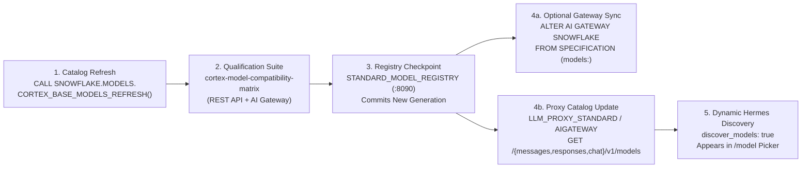

# Model Management

> [!IMPORTANT]
> **Recommended Topology (Option A or Option B):** When Hermes connects to [**`snowflake-proxy-cortexrestapi`**](https://github.com/fbattaglieri-snowflake/snowflake-proxy-cortexrestapi) (`STANDARD_PROXY_ORIGIN`) and/or [**`snowflake-proxy-cortex-aigateway`**](https://github.com/fbattaglieri-snowflake/snowflake-proxy-cortex-aigateway) (`AIGATEWAY_PROXY_ORIGIN`), model qualification, promotion, AI Gateway allowlist sync, and retirement are handled centrally by the proxy's **Single-Writer Model Registry** and **Autonomous Daily Scouting Pipeline** — requiring **zero `models.json` edits and zero Hermes container restarts**.

---

## 1. Recommended Workflow: Shared Multi-API Proxy (Option A & Option B)



When Hermes uses `snowflake-aigateway-{messages,responses,chat}` and/or `snowflake-standard-{messages,responses,chat}` (`discover_models: true`):

1. **Enable Cross-Region Inference (`ANY_REGION`):**
   ```sql
   SHOW PARAMETERS LIKE 'CORTEX_ENABLED_CROSS_REGION' IN ACCOUNT;
   ALTER ACCOUNT SET CORTEX_ENABLED_CROSS_REGION = 'ANY_REGION';
   ```
2. **Refresh the Account Model Catalog (`SNOWFLAKE.MODELS`):**
   ```sql
   CALL SNOWFLAKE.MODELS.CORTEX_BASE_MODELS_REFRESH();
   ```
   > **Option A vs. Option B Catalog Nuance:** Both Cortex REST API and Cortex AI Gateway draw from `SNOWFLAKE.MODELS`. However, Cortex AI Gateway enforces RBAC against `SNOWFLAKE.MODELS` objects (`HTTP 401` if an unreleased PrPr model is not yet listed in `SHOW MODELS IN ACCOUNT`) **and** checks the YAML `models:` allowlist in `DESCRIBE AI GATEWAY SNOWFLAKE`.
3. **Qualify & Promote Zero-Touch:** Run [**`cortex-model-compatibility-matrix`**](https://github.com/fbattaglieri-snowflake/cortex-model-compatibility-matrix) or `scripts/daily_scout_and_promote.py` (`--sync-gateway-spec` when using Option B) to publish the signed `ProfileV2` package to `STANDARD_MODEL_REGISTRY`.
4. **Automatic Discovery in Hermes:** Within 30–60 seconds, the new model is served on `GET /<protocol>/v1/models` and appears automatically in Hermes `/model` — **no `models.json` edits, no `hermes_configure.py` re-runs, and no container restarts**.

---

## 2. Option C (Embedded Fallback Proxy): The Four-Gate Model (`proxy/cortex_proxy.py`)

If you operate in standalone single-container fallback mode (`HERMES_PROVIDER=snowflake-cortex-proxy` on `127.0.0.1:8080`), adding a new Cortex model to the static fallback configuration requires passing four gates:

1. **Gate 1 — Upstream Availability:** Actively served on `/api/v2/cortex/v1/chat/completions` (not merely listed with `lifecycle_status: NULL`).
2. **Gate 2 — Catalog Registration:** Added to `proxy/models.json`.
3. **Gate 3 — Proxy Delivery:** Visible to `cortex_proxy.py` (reloaded automatically on file `mtime` change).
4. **Gate 4 — Hermes Config Patch:** Run `hermes_configure.py --provider snowflake-cortex-proxy --force`.

### Verifying a Candidate Model for the Embedded Proxy: `cortex_model_gate.py`

```bash
CORTEX_PAT="<your-pat>" python3 tooling/cortex_model_gate.py --new
CORTEX_PAT="<your-pat>" python3 tooling/cortex_model_gate.py --all
CORTEX_PAT="<your-pat>" python3 tooling/cortex_model_gate.py --models <model-name>
```

> [!WARNING]
> Place `CORTEX_PAT="..."` as the **first token** of the command. Chaining `cd dir && CORTEX_PAT="..." command` can prevent shell secret injection in some environments, resulting in `HTTP 401` across all models.

| Verdict | Meaning |
|---|---|
| `COMPATIBILE` | Text generation, streaming (`[DONE]`), single tool roundtrip, and parallel tool collapse all passed. |
| `CON RISERVA` | A required check failed, is missing, or is inconclusive. Do not promote to agent mode. |
| `INCOMPATIBILE` | Does not respond with completed text from this account. Do not add to configuration. |

### Refreshing `proxy/models.json`: `refresh_cortex_models.py`

```bash
CORTEX_PAT="..." python3 tooling/refresh_cortex_models.py                   # dry run
CORTEX_PAT="..." python3 tooling/refresh_cortex_models.py --write           # update proxy/models.json
CORTEX_PAT="..." python3 tooling/refresh_cortex_models.py --write --upload  # update + upload to stage
```

---

## 3. Known Cortex Catalog Traps

- **`openai-1p-gpt-*` catalog names:** `SHOW CORTEX BASE MODELS` lists some first-party OpenAI models with a `-1p-` infix (`OPENAI-1P-GPT-5.6-LUNA`), whereas the invocable REST model ID omits `-1p-` (`openai-gpt-5.6-luna`).
- **Reasoning models with small token budgets:** Reasoning models consume output tokens during internal reasoning before emitting text. Always use `>= 1024` tokens in diagnostic probes (`32768` on adaptive Claude 5.x models via the multi-API proxy).
- **Pre-registered models (`lifecycle_status: NULL`):** Models listed with `NULL` lifecycle status return `unknown model` on REST endpoints. Always verify live REST invocability before promotion.
