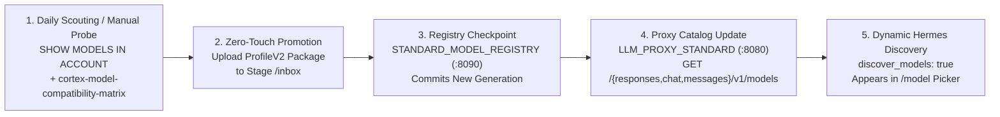

# Model Management

> [!IMPORTANT]
> **Recommended Topology:** When Hermes is connected to the companion [**`snowflake-proxy-cortexrestapi`**](https://github.com/fbattaglieri-snowflake/snowflake-proxy-cortexrestapi) service, model governance, qualification, promotion, and retirement are handled centrally by the proxy and its **Autonomous Daily Model Scouting Pipeline** — requiring **zero static `models.json` edits and zero container restarts**.

---

## 1. Recommended Workflow: Shared Multi-API Proxy (`snowflake-proxy-cortexrestapi`)



When Hermes uses `snowflake-standard-responses`, `snowflake-standard-chat`, and `snowflake-standard-messages` (`discover_models: true`):

1. **Enable Cross-Region Inference (`ANY_REGION`):**
   ```sql
   SHOW PARAMETERS LIKE 'CORTEX_ENABLED_CROSS_REGION' IN ACCOUNT;
   ALTER ACCOUNT SET CORTEX_ENABLED_CROSS_REGION = 'ANY_REGION';
   ```
2. **Qualify the Candidate Model:** Run [**`cortex-model-compatibility-matrix`**](https://github.com/fbattaglieri-snowflake/cortex-model-compatibility-matrix) (`scripts/qualify.py`) or the daily scouting orchestrator (`scripts/daily_scout_and_promote.py` in `snowflake-proxy-cortexrestapi`) against the target protocol (`responses`, `chat`, or `messages`).
3. **Zero-Touch Promotion (or Revocation):** Promote the passing model into the Standard Registry using `scripts/promote_model.py` (or revoke a disappeared model with `--revoke`).
4. **Automatic Discovery in Hermes:** Within 30–60 seconds, the new model is served on `GET /<protocol>/v1/models` and appears automatically in Hermes `/model` — **no `models.json` edits, no `hermes_configure.py` re-runs, and no container restarts required**.

---

## 2. Embedded Fallback Proxy Workflow: The Four-Gate Model (`proxy/cortex_proxy.py`)

If you operate in standalone single-container fallback mode (`HERMES_PROVIDER=snowflake-cortex-proxy` on `127.0.0.1:8080`), adding a new Cortex model to the static Hermes configuration requires passing four gates in sequence:

1. **Gate 1 — Upstream Availability:** The model must be actively served by your Snowflake account on `/api/v2/cortex/v1/chat/completions` (not merely listed in `SHOW CORTEX BASE MODELS` with `lifecycle_status: NULL`).
2. **Gate 2 — Catalog Registration:** The model must be added to `proxy/models.json`.
3. **Gate 3 — Proxy Delivery:** The running `cortex_proxy.py` must see the updated `models.json` (either via image rebuild or stage mount; `cortex_proxy.py` checks file `mtime` on every request).
4. **Gate 4 — Hermes Config Patch:** `hermes_configure.py --provider snowflake-cortex-proxy --force` must be run to write the static model list into `/root/.hermes/config.yaml`.

### Verifying a Candidate Model for the Embedded Proxy: `cortex_model_gate.py`

`tooling/cortex_model_gate.py` tests candidate models against the embedded `cortex_proxy.py` transformation pipeline before promoting them to `proxy/models.json`:

```bash
CORTEX_PAT="<your-pat>" python3 tooling/cortex_model_gate.py --new
CORTEX_PAT="<your-pat>" python3 tooling/cortex_model_gate.py --all
CORTEX_PAT="<your-pat>" python3 tooling/cortex_model_gate.py --models <model-name>
```

> [!WARNING]
> Place `CORTEX_PAT="..."` as the **first token** of the command. Chaining `cd dir && CORTEX_PAT="..." command` can prevent shell secret injection in some environments, resulting in `HTTP 401` across all models.

| Verdict | Meaning |
|---|---|
| `COMPATIBILE` | Text generation, streaming (`[DONE]`), single tool roundtrip, and parallel tool collapse all passed. |
| `CON RISERVA` | A required check failed, is missing, or is inconclusive. Do not promote to agent mode. |
| `INCOMPATIBILE` | Does not respond with completed text from this account. Do not add to configuration. |

### Refreshing `proxy/models.json`: `refresh_cortex_models.py`

```bash
CORTEX_PAT="..." python3 tooling/refresh_cortex_models.py                   # dry run
CORTEX_PAT="..." python3 tooling/refresh_cortex_models.py --write           # update proxy/models.json
CORTEX_PAT="..." python3 tooling/refresh_cortex_models.py --write --upload  # update + upload to stage
```

---

## 3. Known Cortex Catalog Traps

- **`openai-1p-gpt-*` catalog names:** `SHOW CORTEX BASE MODELS` lists some first-party OpenAI models with a `-1p-` infix (`OPENAI-1P-GPT-5.6-LUNA`), whereas the invocable REST model ID omits `-1p-` (`openai-gpt-5.6-luna`).
- **Reasoning models with small token budgets:** Reasoning models consume output tokens during internal reasoning before emitting text. Probes with `< 512` tokens can return `HTTP 200` with empty `content` and `finish_reason: "length"`. Always use `>= 1024` tokens in diagnostic probes.
- **Pre-registered models (`lifecycle_status: NULL`):** Models listed in the catalog with `NULL` lifecycle status return `unknown model` on REST endpoints. Always verify live REST invocability before adding a model.
