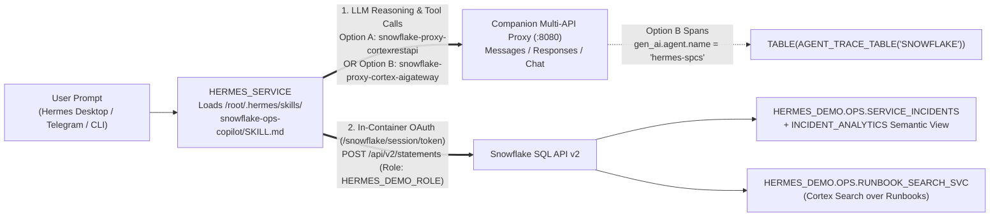

# Synthetic Example: Snowflake Ops Copilot Skill for Hermes Agent

> [!IMPORTANT]
> **Self-Contained & 100% Synthetic — No Maintainer Account Required**
> Every object in this example (`HERMES_DEMO` database, `HERMES_DEMO_WH` warehouse, `HERMES_DEMO_ROLE` least-privilege role, synthetic incident rows, Semantic View, and Cortex Search service) is created from scratch in **your own Snowflake account** by the three SQL scripts in [`sql/`](sql/). Zero private data, credentials, or external tables are referenced.

---

## Architecture Flow



```text
+-----------------------------------------------------------------------------------+
|  1. Run sql/00_role_and_grants.sql  --> Creates HERMES_DEMO_ROLE (least-privilege)|
|  2. Run sql/10_objects.sql          --> Creates tables, Semantic View & Search    |
|  3. Run sql/20_seed.sql             --> Seeds 6 synthetic incidents + 5 runbooks  |
|  4. Copy skill/SKILL.md             --> /root/.hermes/skills/snowflake-ops-copilot|
+-----------------------------------------------------------------------------------+
```

---

## Step-by-Step Setup

### 1. Provision Role, Objects & Synthetic Data

Run the three idempotent SQL scripts against your Snowflake account:

```bash
snow sql -f examples/snowflake-ops-copilot/sql/00_role_and_grants.sql
snow sql -f examples/snowflake-ops-copilot/sql/10_objects.sql
snow sql -f examples/snowflake-ops-copilot/sql/20_seed.sql
```

Then grant `HERMES_DEMO_ROLE` to the Snowflake role that owns your `HERMES_SERVICE` (for example `HERMES_GITHUB_DEPLOY_ROLE`) so the container's `/snowflake/session/token` can switch to `HERMES_DEMO_ROLE`:

```sql
USE ROLE ACCOUNTADMIN;
GRANT ROLE HERMES_DEMO_ROLE TO ROLE <YOUR_HERMES_DEPLOY_ROLE>;
```

### 2. Install the Skill on the Hermes Persistent Volume

Open the Hermes web terminal (`:7681`) or SSH session and copy `SKILL.md` into `/root/.hermes/skills/`:

```bash
mkdir -p /root/.hermes/skills/snowflake-ops-copilot
# Paste or copy examples/snowflake-ops-copilot/skill/SKILL.md into:
# /root/.hermes/skills/snowflake-ops-copilot/SKILL.md
```

Because `/root/.hermes/skills/` lives on the persistent block volume, the skill survives container restarts and image upgrades automatically.

### 3. Sample Prompts to Try in Hermes Desktop, Telegram, or CLI

1. **Incident Triage + Runbook Lookup:**
   > *"Check open or SEV1 incidents in `HERMES_DEMO.OPS`, find the matching remediation runbook via Cortex Search, and propose an action plan."*
2. **MTTR Breakdown:**
   > *"Compute incident count, average MTTR, and total affected tenants by region from `HERMES_DEMO.OPS.SERVICE_INCIDENTS`."*
3. **Self-Observability (when running on Option B — Cortex AI Gateway):**
   > *"Query `TABLE(AGENT_TRACE_TABLE('SNOWFLAKE'))` for `hermes-spcs` over the last hour and summarize token usage and latency by model."*
